

# 🚀 Awesome DSA Visualizers & LeetCode Patterns

  <b>Interactive, step-by-step visual solutions for 100+ Data Structures & Algorithms and 325 LeetCode problems with line-by-line code tracing.</b>

 

[✨ Explore All Visualizers](https://faangprep.com/dsa/) &nbsp;|&nbsp;
[🔥 18 LeetCode Patterns](https://faangprep.com/dsa-patterns/) &nbsp;|&nbsp;
[⚡ Grind 75 Tracker](https://faangprep.com/grind-75/) &nbsp;|&nbsp;
[📚 Blind 75 Sheet](https://faangprep.com/blind-75/) &nbsp;|&nbsp;
[🎯 LeetCode 75 Roadmap](https://faangprep.com/leetcode-75/)

 

---

## 💡 Why This Exists

Most developers struggle to build deep intuition for algorithms by passively watching video tutorials or reading static text dry-runs. **True intuition clicks when you step through the execution yourself**:

- 🔍 **Line-by-Line Execution:** See the exact statement highlighted as variables, pointers, and memory mutate.
- ⏱️ **Real-Time Complexity Analysis:** Time and auxiliary space counters update dynamically at each step.
- 🧩 **Zero Fluff:** Clean, interactive browser execution without needing accounts or credit cards to start.

---

## 🎬 Featured Visualizer Showcases

### 1. Quick Sort: In-Place Partitioning & Pivot Swapping
*Watch the pivot element partition the array into smaller and larger subarrays step-by-step.*

<a href="https://faangprep.com/dsa/sorting/quick-sort/">
  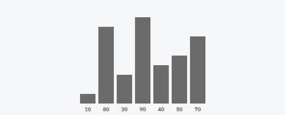
</a>

👉 **[Try Quick Sort Live ↗](https://faangprep.com/dsa/sorting/quick-sort/)**

 

### 2. Binary Search: Dynamic Pointer Convergence
*Observe low, mid, and high pointers narrow down the search space in $O(\log n)$ logarithmic time.*

<a href="https://faangprep.com/dsa/searching/binary-search/">
  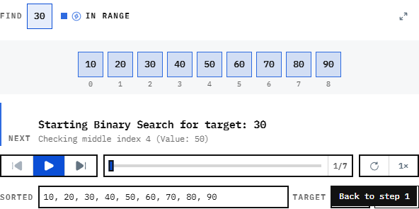
</a>

👉 **[Try Binary Search Live ↗](https://faangprep.com/dsa/searching/binary-search/)**

 

### 3. LeetCode Pattern: Two Pointers (Two Sum II)
*Step through canonical LeetCode interview patterns with real pointer convergence and condition checks.*

<a href="https://faangprep.com/dsa-patterns/two-pointers/two-sum-ii-input-array-is-sorted/">
  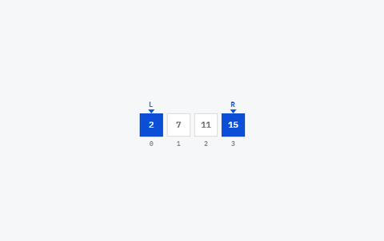
</a>

👉 **[Try Two Sum II Visual Solution ↗](https://faangprep.com/dsa-patterns/two-pointers/two-sum-ii-input-array-is-sorted/)**

 

### 4. Dijkstra's Algorithm: Shortest Path Finding
*Watch unvisited nodes, edge relaxation, and greedy shortest path discovery across weighted graphs.*

<a href="https://faangprep.com/dsa/structures/dijkstras-algorithm/">
  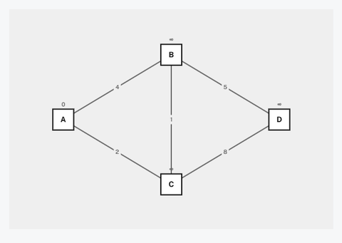
</a>

👉 **[Try Dijkstra's Algorithm Live ↗](https://faangprep.com/dsa/structures/dijkstras-algorithm/)**

 

### 5. Dynamic Programming: State Transitions & Memoization
*Watch the state tree transition into an $O(n)$ linear iterative array table.*

<a href="https://faangprep.com/dsa/dp/fibonacci-sequence/">
  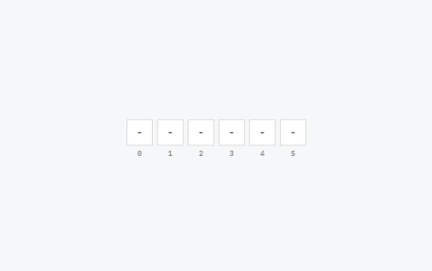
</a>

👉 **[Try DP Fibonacci Live ↗](https://faangprep.com/dsa/dp/fibonacci-sequence/)**

 

### 6. Kadane's Algorithm: Maximum Subarray Window
*Track the running sum resetting vs. extending in optimal $O(n)$ time.*

<a href="https://faangprep.com/dsa/arrays/kadanes-algorithm/">
  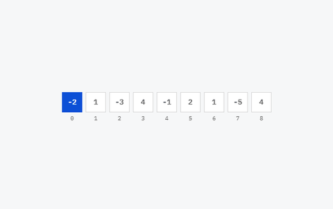
</a>

👉 **[Try Kadane's Algorithm Live ↗](https://faangprep.com/dsa/arrays/kadanes-algorithm/)**

 

### 7. Breadth-First Search (BFS): Graph Level Order Traversal
*Observe queue-driven level expansion across undirected graph rings.*

<a href="https://faangprep.com/dsa/structures/breadth-first-search/">
  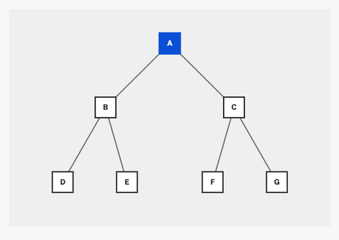
</a>

👉 **[Try Breadth-First Search Live ↗](https://faangprep.com/dsa/structures/breadth-first-search/)**

---

## 📋 Table of Contents

- [Curated Interview Sheets & Progress Trackers](#-curated-interview-sheets--progress-trackers)
- [18 LeetCode Coding Patterns (325 Problems)](#-18-leetcode-coding-patterns-325-problems)
- [Sorting Algorithms](#-sorting-algorithms)
- [Searching Algorithms](#-searching-algorithms)
- [Core Data Structures](#-core-data-structures)
- [Dynamic Programming](#-dynamic-programming)
- [Graph Algorithms](#-graph-algorithms)
- [Advanced Algorithms & String Matching](#-advanced-algorithms--string-matching)
- [Contributing & Community](#-contributing)

---

## 🎯 Curated Interview Sheets & Progress Trackers

All sheets feature one-line problem approaches, time/space complexity tags, and **browser-saved progress tracking**.

| Curated Sheet | Coverage | Live Visual Solution | Tracker Link |
| :--- | :---: | :---: | :--- |
| **Grind 75 Tracker** | 75 Problems | 100% Visualized | [Launch Grind 75 ↗](https://faangprep.com/grind-75/) |
| **Blind 75 Revision Sheet** | 75 Problems | 100% Visualized | [Launch Blind 75 ↗](https://faangprep.com/blind-75/) |
| **LeetCode 75 Roadmap** | 75 Problems | 100% Visualized | [Launch LeetCode 75 ↗](https://faangprep.com/leetcode-75/) |
| **NeetCode 150 Roadmap** | 150 Problems | 100% Visualized | [Launch NeetCode 150 ↗](https://faangprep.com/neetcode-150/) |
| **Big-O Complexity Cheat Sheet** | All Structures | Full Chart | [View Big-O Cheat Sheet ↗](https://faangprep.com/dsa/big-o-cheat-sheet/) |
| **DSA Pattern Recognition Guide** | 18 Patterns | Problem Signals | [Read Pattern Guide ↗](https://faangprep.com/dsa-patterns/cheat-sheet/) |

---

## 🧩 18 LeetCode Coding Patterns (325 Problems)

Master interview problems by understanding the underlying pattern rather than memorizing individual solutions:

| Coding Pattern | Visual Preview | Problems | Key Intuition | Visualizer Link |
| :--- | :---: | :---: | :--- | :--- |
| **Two Pointers** |  | 36 | Opposing or parallel index traversal on sorted sequences | [Explore Pattern ↗](https://faangprep.com/dsa-patterns/two-pointers/) |
| **Sliding Window** | <a href="https://faangprep.com/dsa-patterns/sliding-window/">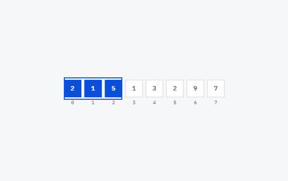</a> | 21 | Expand/shrink contiguous subarray boundaries | [Explore Pattern ↗](https://faangprep.com/dsa-patterns/sliding-window/) |
| **Monotonic Stack** | <a href="https://faangprep.com/dsa-patterns/stack/">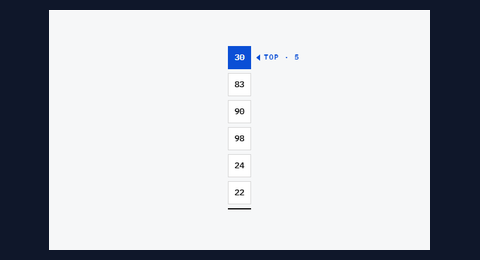</a> | 24 | Maintain monotonic invariant for Next Greater/Lesser | [Explore Pattern ↗](https://faangprep.com/dsa-patterns/stack/) |
| **Binary Search** |  | 18 | Halve monotonic solution search spaces | [Explore Pattern ↗](https://faangprep.com/dsa-patterns/binary-search/) |
| **Breadth-First Search (BFS)** |  | 17 | Level-order traversal & unweighted shortest paths | [Explore Pattern ↗](https://faangprep.com/dsa-patterns/breadth-first-search/) |
| **Depth-First Search (DFS)** | <a href="https://faangprep.com/dsa-patterns/depth-first-search/">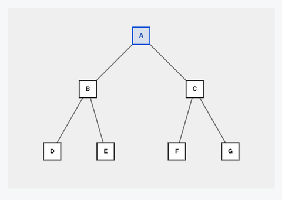</a> | 43 | Recursive tree branch exploration & path finding | [Explore Pattern ↗](https://faangprep.com/dsa-patterns/depth-first-search/) |
| **Dynamic Programming** |  | 40 | Overlapping subproblems with optimal substructure | [Explore Pattern ↗](https://faangprep.com/dsa-patterns/dynamic-programming/) |
| **Fast & Slow Pointers** | <a href="https://faangprep.com/dsa-patterns/linked-list/">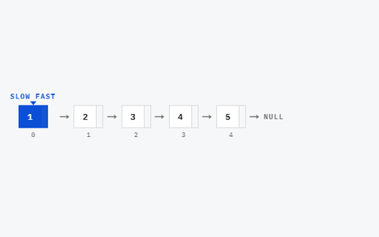</a> | 23 | Floyd's cycle detection and midpoint discovery | [Explore Pattern ↗](https://faangprep.com/dsa-patterns/linked-list/) |
| **Heap / Priority Queue** | <a href="https://faangprep.com/dsa-patterns/heap-priority-queue/">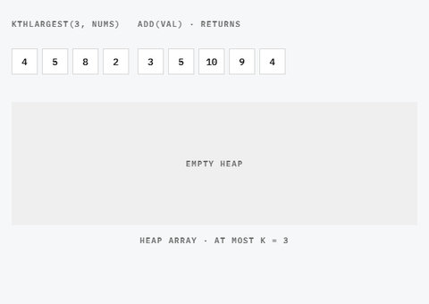</a> | 13 | Dynamic min/max discovery and Top-K elements | [Explore Pattern ↗](https://faangprep.com/dsa-patterns/heap-priority-queue/) |
| **Backtracking** | <a href="https://faangprep.com/dsa-patterns/backtracking/">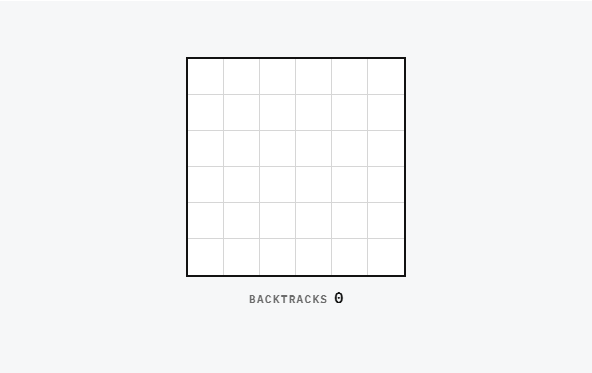</a> | 16 | Constraint satisfaction with state reversion | [Explore Pattern ↗](https://faangprep.com/dsa-patterns/backtracking/) |
| **Greedy Algorithms** |  | 17 | Locally optimal choices leading to global optima | [Explore Pattern ↗](https://faangprep.com/dsa-patterns/greedy-algorithms/) |
| **Intervals** | <a href="https://faangprep.com/dsa-patterns/intervals/">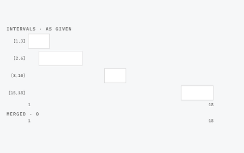</a> | 9 | Sorting by start time, merging overlapping ranges | [Explore Pattern ↗](https://faangprep.com/dsa-patterns/intervals/) |
| **Trie (Prefix Tree)** |  | 6 | Multi-way tree for prefix queries and autocomplete | [Explore Pattern ↗](https://faangprep.com/dsa-patterns/trie/) |
| **Prefix Sum** | <a href="https://faangprep.com/dsa-patterns/prefix-sum/">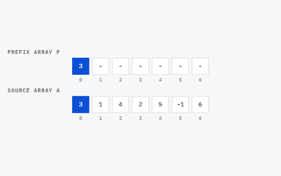</a> | 6 | Range sum queries in constant $O(1)$ time | [Explore Pattern ↗](https://faangprep.com/dsa-patterns/prefix-sum/) |
| **Bit Manipulation** | <a href="https://faangprep.com/dsa-patterns/bit-manipulation/">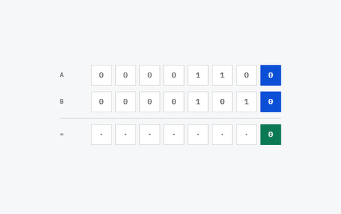</a> | 9 | Bitwise operators for constant-space arithmetic | [Explore Pattern ↗](https://faangprep.com/dsa-patterns/bit-manipulation/) |
| **Graphs & Topo Sort** | <a href="https://faangprep.com/dsa-patterns/graphs/">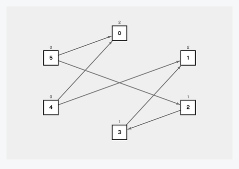</a> | 13 | Dependency resolution and Kahn's algorithm | [Explore Pattern ↗](https://faangprep.com/dsa-patterns/graphs/) |
| **Hash Map / Frequency** | <a href="https://faangprep.com/dsa-patterns/hash-map/">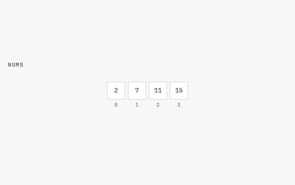</a> | 20 | Constant-time lookup and complement caching | [Explore Pattern ↗](https://faangprep.com/dsa-patterns/hash-map/) |
| **Matrices** | <a href="https://faangprep.com/dsa-patterns/matrices/">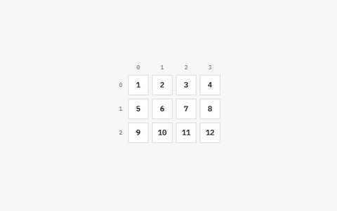</a> | 3 | 2D array traversal, spiral paths & rotations | [Explore Pattern ↗](https://faangprep.com/dsa-patterns/matrices/) |

---

## ⚡ Sorting Algorithms

| Algorithm | Visual Preview | Best Time | Average Time | Worst Time | Space | Live Interactive Demo |
| :--- | :---: | :---: | :---: | :---: | :---: | :--- |
| **Quick Sort** |  | $O(n \log n)$ | $O(n \log n)$ | $O(n^2)$ | $O(\log n)$ | [Step Through ↗](https://faangprep.com/dsa/sorting/quick-sort/) |
| **Merge Sort** | <a href="https://faangprep.com/dsa/sorting/merge-sort/">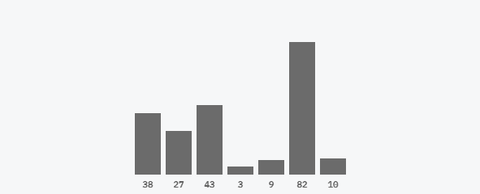</a> | $O(n \log n)$ | $O(n \log n)$ | $O(n \log n)$ | $O(n)$ | [Step Through ↗](https://faangprep.com/dsa/sorting/merge-sort/) |
| **Bubble Sort** | <a href="https://faangprep.com/dsa/sorting/bubble-sort/">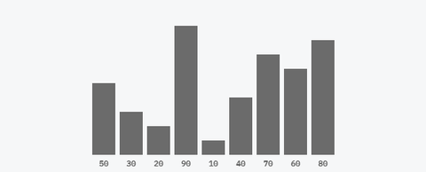</a> | $O(n)$ | $O(n^2)$ | $O(n^2)$ | $O(1)$ | [Step Through ↗](https://faangprep.com/dsa/sorting/bubble-sort/) |
| **Insertion Sort** |  | $O(n)$ | $O(n^2)$ | $O(n^2)$ | $O(1)$ | [Step Through ↗](https://faangprep.com/dsa/sorting/insertion-sort/) |
| **Selection Sort** | <a href="https://faangprep.com/dsa/sorting/selection-sort/">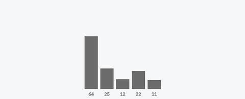</a> | $O(n^2)$ | $O(n^2)$ | $O(n^2)$ | $O(1)$ | [Step Through ↗](https://faangprep.com/dsa/sorting/selection-sort/) |
| **Heap Sort** | <a href="https://faangprep.com/dsa/advanced/heap-sort/">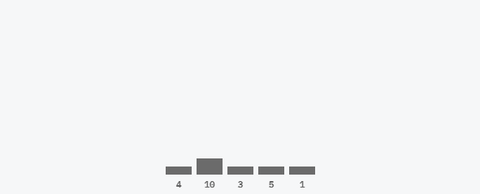</a> | $O(n \log n)$ | $O(n \log n)$ | $O(n \log n)$ | $O(1)$ | [Step Through ↗](https://faangprep.com/dsa/advanced/heap-sort/) |
| **Counting Sort** | <a href="https://faangprep.com/dsa/sorting/counting-sort/">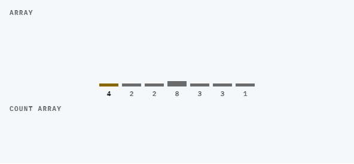</a> | $O(n + k)$ | $O(n + k)$ | $O(n + k)$ | $O(k)$ | [Step Through ↗](https://faangprep.com/dsa/sorting/counting-sort/) |
| **Radix Sort** | <a href="https://faangprep.com/dsa/sorting/radix-sort/">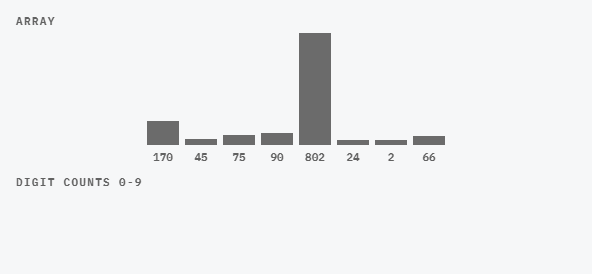</a> | $O(d \cdot (n + k))$ | $O(d \cdot (n + k))$ | $O(d \cdot (n + k))$ | $O(n + k)$ | [Step Through ↗](https://faangprep.com/dsa/sorting/radix-sort/) |
| **Bucket Sort** | <a href="https://faangprep.com/dsa/sorting/bucket-sort/">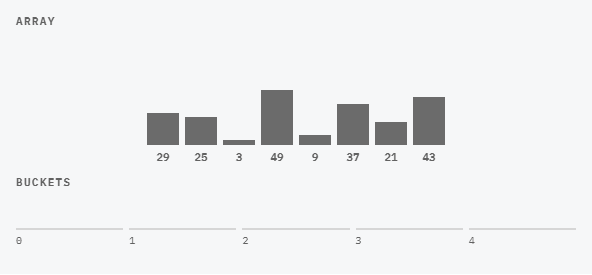</a> | $O(n + k)$ | $O(n + k)$ | $O(n^2)$ | $O(n)$ | [Step Through ↗](https://faangprep.com/dsa/sorting/bucket-sort/) |
| **Shell Sort** | <a href="https://faangprep.com/dsa/sorting/shell-sort/">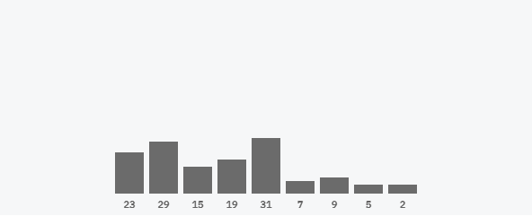</a> | $O(n \log n)$ | $O(n^{4/3})$ | $O(n^{3/2})$ | $O(1)$ | [Step Through ↗](https://faangprep.com/dsa/sorting/shell-sort/) |

---

## 🔍 Searching Algorithms

| Algorithm | Visual Preview | Average Time | Worst Time | Space | Live Interactive Demo |
| :--- | :---: | :---: | :---: | :---: | :--- |
| **Binary Search** |  | $O(\log n)$ | $O(\log n)$ | $O(1)$ | [Step Through ↗](https://faangprep.com/dsa/searching/binary-search/) |
| **Linear Search** |  | $O(n)$ | $O(n)$ | $O(1)$ | [Step Through ↗](https://faangprep.com/dsa/searching/linear-search/) |
| **Jump Search** | *Coming Soon* | $O(\sqrt{n})$ | $O(\sqrt{n})$ | $O(1)$ | *Coming Soon* |
| **Interpolation Search** | *Coming Soon* | $O(\log \log n)$ | $O(n)$ | $O(1)$ | *Coming Soon* |
| **Exponential Search** | *Coming Soon* | $O(\log n)$ | $O(\log n)$ | $O(1)$ | *Coming Soon* |

---

## 🌳 Core Data Structures

| Data Structure | Visual Preview | Operations & Mechanics Visualized | Live Interactive Demo |
| :--- | :---: | :--- | :--- |
| **Stack (LIFO)** |  | Push, pop, peek, and call stack frames | [Step Through ↗](https://faangprep.com/dsa/structures/stack/) |
| **Queue (FIFO)** | <a href="https://faangprep.com/dsa/structures/queue/">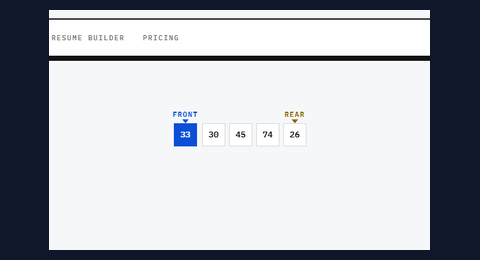</a> | Enqueue, dequeue, circular buffer wraps | [Step Through ↗](https://faangprep.com/dsa/structures/queue/) |
| **Singly Linked List** | <a href="https://faangprep.com/dsa/structures/singly-linked-list/">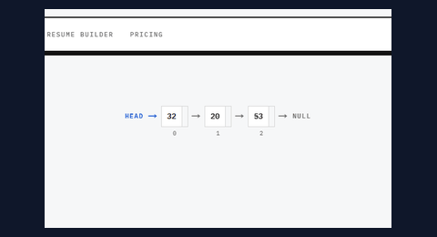</a> | Head/tail insertion, middle deletion, and reversal | [Step Through ↗](https://faangprep.com/dsa/structures/singly-linked-list/) |
| **Binary Search Tree** | <a href="https://faangprep.com/dsa/structures/binary-search-tree/">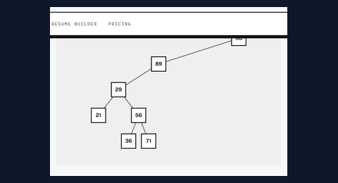</a> | Insert, search, delete, and in-order/pre-order traversal | [Step Through ↗](https://faangprep.com/dsa/structures/binary-search-tree/) |
| **AVL Tree** | <a href="https://faangprep.com/dsa/structures/avl-tree/">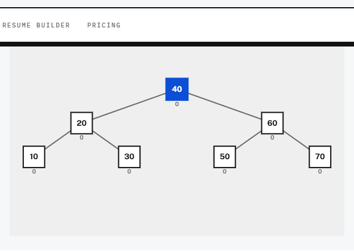</a> | Left/Right & Left-Right/Right-Left self-balancing rotations | [Step Through ↗](https://faangprep.com/dsa/structures/avl-tree/) |
| **Red-Black Tree** | <a href="https://faangprep.com/dsa/structures/red-black-tree/">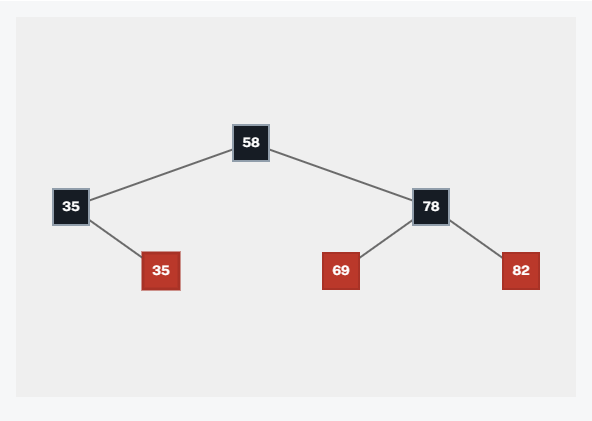</a> | Node coloring, uncle balancing, and recoloring passes | [Step Through ↗](https://faangprep.com/dsa/structures/red-black-tree/) |
| **Min/Max Binary Heap** | <a href="https://faangprep.com/dsa/advanced/heap-visualizer/">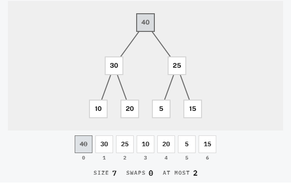</a> | Heapify up, heapify down, extract-min, and priority queues | [Step Through ↗](https://faangprep.com/dsa/advanced/heap-visualizer/) |
| **Doubly Linked List** |  | Forward/backward pointer relinking | [Step Through ↗](https://faangprep.com/dsa/structures/doubly-linked-list/) |
| **Circular Linked List** |  | Tail-to-head cycle maintenance | [Step Through ↗](https://faangprep.com/dsa/structures/circular-linked-list/) |
| **Hash Map** | <a href="https://faangprep.com/dsa/hashing/hash-map/">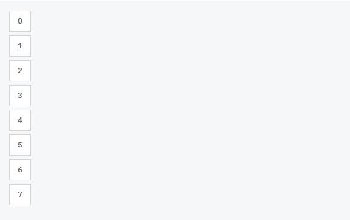</a> | Bucket hashing, collision resolution via chaining/probing | [Step Through ↗](https://faangprep.com/dsa/hashing/hash-map/) |
| **Trie (Prefix Tree)** | <a href="https://faangprep.com/dsa/advanced/trie-introduction/">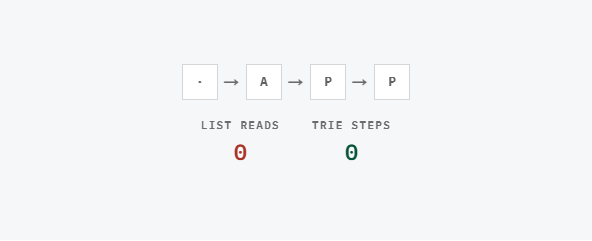</a> | Character node insertion, prefix match traversal | [Step Through ↗](https://faangprep.com/dsa/advanced/trie-introduction/) |
| **Disjoint Set (Union-Find)** | <a href="https://faangprep.com/dsa/advanced/disjoint-set-visualizer/">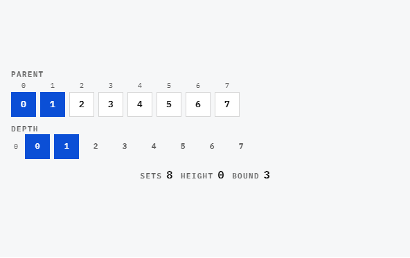</a> | Path compression and rank union | [Step Through ↗](https://faangprep.com/dsa/advanced/disjoint-set-visualizer/) |

---

## 📈 Dynamic Programming

| Problem / Algorithm | Visual Preview | Intuition | Complexity | Live Demo |
| :--- | :---: | :--- | :---: | :--- |
| **Fibonacci Sequence** |  | Recursion vs Memoization vs Bottom-up Tabulation | $O(n)$ / $O(1)$ | [Step Through ↗](https://faangprep.com/dsa/dp/fibonacci-sequence/) |
| **0/1 Knapsack** | <a href="https://faangprep.com/dsa/dp/0-1-knapsack/">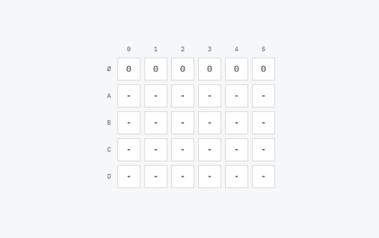</a> | 2D weight vs capacity value maximization | $O(n \cdot W)$ | [Step Through ↗](https://faangprep.com/dsa/dp/0-1-knapsack/) |
| **Climbing Stairs** | <a href="https://faangprep.com/dsa/dp/climbing-stairs/">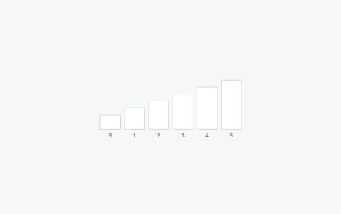</a> | Recurrence transition step modeling | $O(n)$ | [Step Through ↗](https://faangprep.com/dsa/dp/climbing-stairs/) |
| **Longest Common Subsequence** | <a href="https://faangprep.com/dsa/dp/longest-common-subsequence/">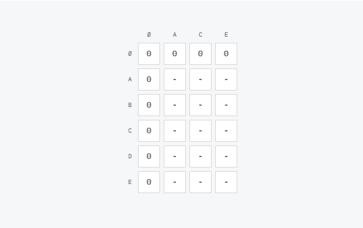</a> | Character match diagonal increment vs row/col carry | $O(m \cdot n)$ | [Step Through ↗](https://faangprep.com/dsa/dp/longest-common-subsequence/) |
| **Edit Distance (Levenshtein)** | <a href="https://faangprep.com/dsa/dp/edit-distance/">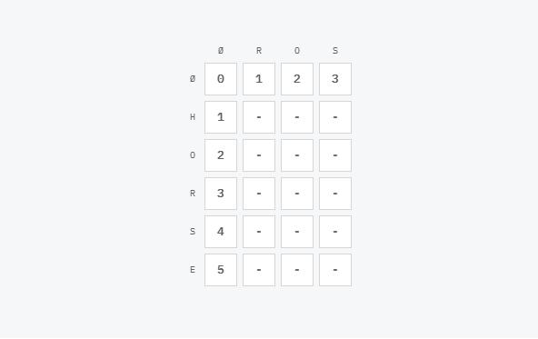</a> | Insertion, deletion, substitution matrix alignment | $O(m \cdot n)$ | [Step Through ↗](https://faangprep.com/dsa/dp/edit-distance/) |
| **Subset Sum** | <a href="https://faangprep.com/dsa/dp/subset-sum/">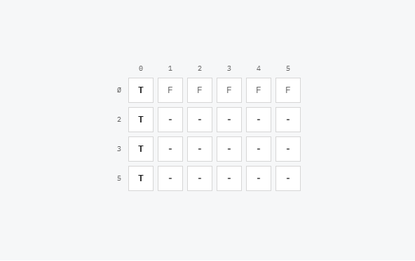</a> | Boolean reachability dynamic table | $O(n \cdot \text{sum})$ | [Step Through ↗](https://faangprep.com/dsa/dp/subset-sum/) |
| **Max Path Sum in Grid** | <a href="https://faangprep.com/dsa/dp/max-path-sum/">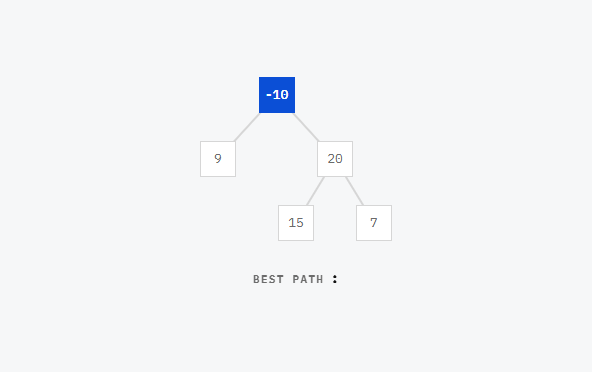</a> | Dynamic grid traversal accumulation | $O(m \cdot n)$ | [Step Through ↗](https://faangprep.com/dsa/dp/max-path-sum/) |
| **Bitmask DP** | <a href="https://faangprep.com/dsa/advanced/bitmask-dp/">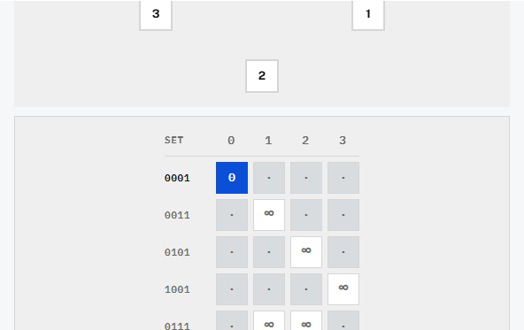</a> | Exponential state compression with bit flags | $O(n^2 2^n)$ | [Step Through ↗](https://faangprep.com/dsa/advanced/bitmask-dp/) |

---

## 🕸️ Graph Algorithms

| Algorithm | Visual Preview | Purpose | Complexity | Live Demo |
| :--- | :---: | :--- | :---: | :--- |
| **Breadth-First Search (BFS)** |  | Shortest path in unweighted graphs & level order | $O(V + E)$ | [Step Through ↗](https://faangprep.com/dsa/structures/breadth-first-search/) |
| **Depth-First Search (DFS)** |  | Connected components, cycle detection | $O(V + E)$ | [Step Through ↗](https://faangprep.com/dsa/structures/depth-first-search/) |
| **Dijkstra's Algorithm** |  | Single-source shortest path with non-negative weights | $O((V + E) \log V)$ | [Step Through ↗](https://faangprep.com/dsa/structures/dijkstras-algorithm/) |
| **Bellman-Ford Algorithm** | <a href="https://faangprep.com/dsa/structures/bellman-ford-algorithm/">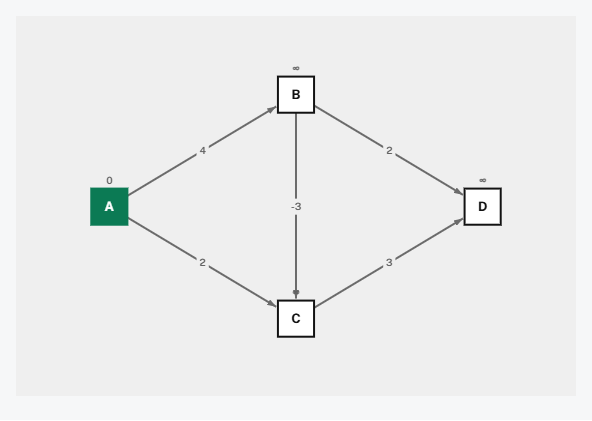</a> | Shortest path with negative edge cycles | $O(V \cdot E)$ | [Step Through ↗](https://faangprep.com/dsa/structures/bellman-ford-algorithm/) |
| **Floyd-Warshall** | <a href="https://faangprep.com/dsa/structures/floyd-warshall-algorithm/">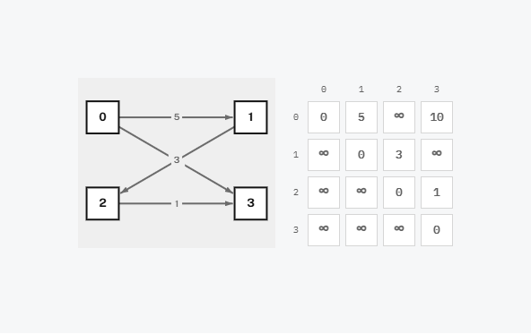</a> | All-pairs shortest path dynamic matrix | $O(V^3)$ | [Step Through ↗](https://faangprep.com/dsa/structures/floyd-warshall-algorithm/) |
| **Kruskal's Algorithm** |  | Minimum Spanning Tree via Union-Find | $O(E \log E)$ | [Step Through ↗](https://faangprep.com/dsa/structures/minimum-spanning-tree/) |
| **Prim's Algorithm** | <a href="https://faangprep.com/dsa/structures/minimum-spanning-tree/">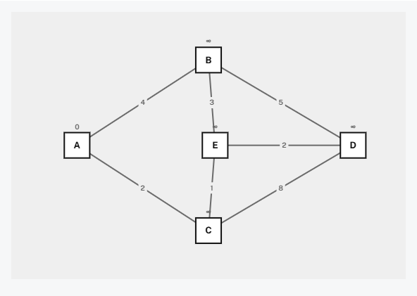</a> | Minimum Spanning Tree via Priority Queue | $O(E \log V)$ | [Step Through ↗](https://faangprep.com/dsa/structures/minimum-spanning-tree/) |
| **Topological Sort** | <a href="https://faangprep.com/dsa/structures/topological-sort/">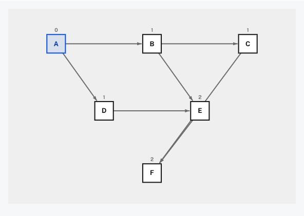</a> | Dependency ordering via in-degree queues (Kahn's) | $O(V + E)$ | [Step Through ↗](https://faangprep.com/dsa/structures/topological-sort/) |
| **Bridges & Articulation Points** | <a href="https://faangprep.com/dsa/structures/bridges-and-articulation-points/">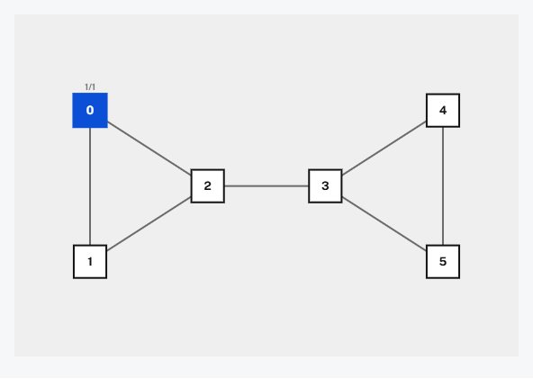</a> | Tarjan's low-link discovery time | $O(V + E)$ | [Step Through ↗](https://faangprep.com/dsa/structures/bridges-and-articulation-points/) |

---

## 🎯 Advanced Algorithms & String Matching

| Algorithm | Visual Preview | Category | Complexity | Live Demo |
| :--- | :---: | :--- | :---: | :--- |
| **KMP Algorithm** | <a href="https://faangprep.com/dsa/strings/kmp-algorithm/">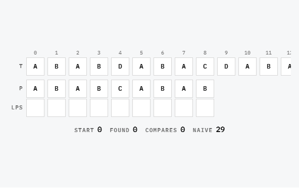</a> | Prefix function ($\pi$-table) linear pattern matching | $O(n + m)$ | [Step Through ↗](https://faangprep.com/dsa/strings/kmp-algorithm/) |
| **Rabin-Karp** | <a href="https://faangprep.com/dsa/strings/rabin-karp/">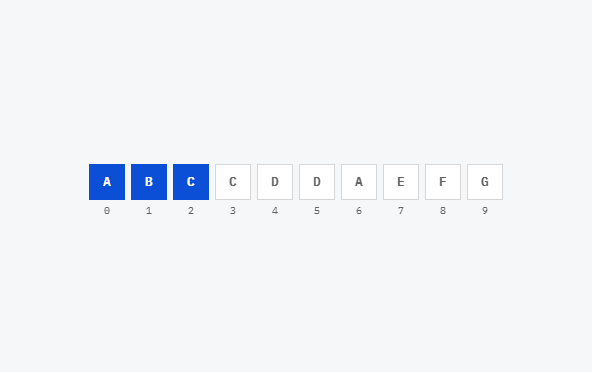</a> | Rolling polynomial hash pattern matching | $O(n + m)$ | [Step Through ↗](https://faangprep.com/dsa/strings/rabin-karp/) |
| **Z-Algorithm** |  | Longest common prefix array matching | $O(n + m)$ | [Step Through ↗](https://faangprep.com/dsa/advanced/z-algorithm/) |
| **Suffix Array & LCP** |  | Kasai's algorithm string indexing | $O(n \log n)$ | [Step Through ↗](https://faangprep.com/dsa/advanced/suffix-array/) |
| **Mo's Algorithm** |  | Square-root decomposition offline range queries | $O((n + q) \sqrt{n})$ | [Step Through ↗](https://faangprep.com/dsa/advanced/mos-algorithm-visualizer/) |
| **Sweep Line Technique** |  | Geometric interval & event line sweeping | $O(n \log n)$ | [Step Through ↗](https://faangprep.com/dsa/advanced/meeting-rooms/) |

---

## 🤝 Contributing

Contributions, algorithm requests, and bug reports are warmly welcomed!

- 🐛 **Found a bug in a visualizer?** Please [open an issue](https://github.com/jacksonsebastian/awesome-dsa-visualizers/issues).
- 💡 **Want a new algorithm visualized?** Suggest it in the issues or open a pull request!

---

### ⭐ Support This Open-Source Resource

If these interactive visualizers helped you understand algorithms or prepare for interviews, please consider giving this repository a star!

 

Crafted with ❤️ for interview candidates by [FaangPrep](https://faangprep.com).

